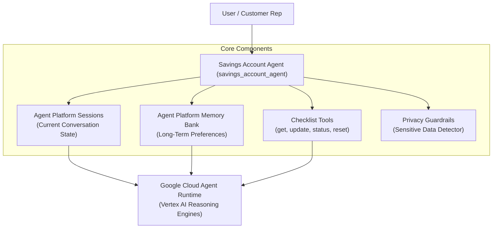

# Savings Account Opening Checklist Agent (`savings_account_agent`)

[](https://www.python.org/downloads/)
[](https://adk.dev)
[](LICENSE)

An enterprise-ready, read-only **Savings Account Opening Assistant** built with **Google Agent Development Kit (ADK)**, **Gemini**, **Agent Platform Sessions**, **Agent Platform Memory Bank**, and **Agent Runtime**.

---

## 1. Project Overview

The `savings_account_agent` provides interactive guidance to bank staff or customer service representatives as they complete the checklist required for opening a savings account.

> [!IMPORTANT]
> **Demo & Checklist Assistant Scope**:
> - This agent is strictly a **checklist assistant**.
> - It does **NOT** connect to a live banking core system.
> - It does **NOT** execute financial transactions or fund transfers.
> - It does **NOT** store real customer KYC documents or raw sensitive numbers.

---

## 2. Business Use Case

Opening a savings account requires gathering and verifying specific customer details. The agent systematically tracks progress across 9 required checklist items:

1. **Full Name**
2. **Date of Birth**
3. **Mobile Number**
4. **Address**
5. **PAN Availability**
6. **Identity Proof Availability**
7. **Address Proof Availability**
8. **Photograph Availability**
9. **Nominee Information**

Instead of storing raw sensitive documents, the agent tracks item statuses (`PROVIDED`, `PENDING`, `NOT_APPLICABLE`).

---

## 3. Architecture



---

## 4. Sessions (Agent Platform Sessions)

A **Session** maintains conversation history and current application progress (`session.state["checklist"]`).

- Preserves conversation context throughout account opening.
- Allows pausing and continuing applications seamlessly.
- State persists item statuses (`PROVIDED`, `PENDING`, `NOT_APPLICABLE`).

---

## 5. Memory Bank (Agent Platform Memory Bank)

**Memory Bank** retains long-term user preferences across multiple sessions (scoped by `user_id`).

### Allowed Memories
- User language preferences (e.g. "User prefers Telugu explanations").
- Interaction style (concise explanations, table formats).

### Prohibited Memories
- Raw PAN, Aadhaar, Credit/Debit card numbers, CVV, PIN, OTP, Passwords, or Account numbers.

---

## 6. Agent Runtime Deployment

The agent deploys natively to **Google Cloud Agent Runtime** (Vertex AI Reasoning Engines) via ADK (`agents-cli` / `google-cloud-aiplatform`).

- Containerized execution.
- Managed autoscaling and session persistence.
- Enterprise IAM and audit capability.

---

## 7. Checklist Workflow & Response Format

The agent renders progress using a clean, structured table format:

```text
Savings Account Checklist

✓ Full Name
✓ Date of Birth
✓ Mobile
○ Address
✓ PAN
○ Identity Proof
○ Address Proof
✓ Photograph
○ Nominee

Progress: 5/9

Next required item:
Address
```

---

## 8. Privacy Guardrails

Automatic regex patterns detect:
- **PAN** (`[A-Z]{5}[0-9]{4}[A-Z]{1}`)
- **Aadhaar** (12-digit number)
- **Credit/Debit Card** (13–19 digits)
- **CVV / PIN / OTP**
- **Bank Account Numbers**

### Privacy Actions
1. Replaces secret tokens with `[REDACTED_<TYPE>]`.
2. Emits privacy notice:
   > *"For privacy and security, sensitive information (PAN) has been marked as provided. The exact value will not be stored, logged, or repeated."*
3. Ensures raw values are purged before session data reaches Memory Bank or telemetry.

---

## 9. Tools

| Tool | Parameters | Description |
|------|------------|-------------|
| `get_account_checklist()` | None | Returns required checklist items array and `account_type="SAVINGS"`. |
| `update_checklist(item, status)` | `item: str`, `status: str` | Updates item status (`PROVIDED`, `PENDING`, `NOT_APPLICABLE`). |
| `get_checklist_status()` | None | Returns total count, completion percentage, next item, and formatted checklist table. |
| `reset_checklist()` | None | Resets current checklist to initial `PENDING` state for a new application. |

---

## 10. Local Development

### Prerequisites
- Python 3.10+
- Google Cloud Project with Vertex AI API enabled

### Setup Environment
```bash
git clone https://github.com/vimalsagar007/savings-account-agent.git
cd savings-account-agent

python3 -m venv .venv
source .venv/bin/activate
pip install -e .
```

---

## 11. Authentication & Environment

Set environment variables (no hardcoded keys):

```bash
export GOOGLE_CLOUD_PROJECT="your-gcp-project-id"
export GOOGLE_CLOUD_LOCATION="us-central1"
export GOOGLE_GENAI_USE_ENTERPRISE="true"
export MODEL_NAME="gemini-2.5-flash"
export STAGING_BUCKET="gs://your-staging-bucket-name"
```

Authenticate with Google Application Default Credentials:
```bash
gcloud auth application-default login
```

---

## 12. Local FastAPI Server

Start the local test server:
```bash
uvicorn app:app --reload --port 8000
```

### Endpoints
- `GET /health`: Health check
- `POST /chat`: Send prompt to agent
- `GET /checklist`: Fetch checklist status
- `POST /checklist/reset`: Reset session checklist

---

## 13. Deployment to Agent Runtime

Deploy using `deploy.py`:
```bash
python3 deploy.py
```

Or via `agents-cli`:
```bash
agents-cli deploy --deployment-target agent_runtime --project $GOOGLE_CLOUD_PROJECT --region $GOOGLE_CLOUD_LOCATION --no-confirm-project
```

---

## 14. Testing & Verification Guide

Follow these step-by-step instructions to test all capabilities of the agent across local, script, FastAPI, and deployed Google Cloud environments.

### Step 1: Run Automated Unit Tests (`pytest`)
Execute the test suite covering checklist tools, privacy guardrails, session continuation, and Memory Bank redaction:

```bash
# Ensure virtualenv is activated or reference directly
pytest -v
```

**Expected Result:**
```text
======================== 16 passed in 0.94s =========================
```

**Test Coverage Breakdown:**
- `test_checklist.py`: Tests checklist retrieval, item status updates, completion percentage, and checklist reset.
- `test_privacy.py`: Tests regex detection for PAN, Aadhaar, Credit Card, CVV, OTP, and input sanitization/redaction.
- `test_session.py`: Tests session initialization, state persistence across turns, and multi-session continuation.
- `test_memory.py`: Tests Memory Bank retrieval for language preference ("Telugu") and verifies raw sensitive values are excluded from Memory Bank.

---

### Step 2: Run Interactive Demo Scripts

#### A. Session Continuation Demo
Tests session creation, multi-turn state updates, language preference setting, and resuming in Session 2:

```bash
PYTHONPATH=. python3 scripts/session_demo.py
```

**What it verifies:**
- Session 1 receives user details ("Rahul", mobile, PAN availability).
- User requests Telugu language explanations.
- Session 2 resumes with stored checklist state and responds in Telugu.

#### B. Memory Bank & Privacy Audit Demo
Tests cross-session long-term memory and verifies zero leakage of sensitive PAN numbers:

```bash
PYTHONPATH=. python3 scripts/memory_demo.py
```

**What it verifies:**
- Memory Bank retrieves user preference across separate sessions.
- Privacy audit confirms raw PAN token (`ABCDE1234F`) is never present in memory search results.

---

### Step 3: Test Local FastAPI Endpoints

Start the FastAPI application in terminal 1:
```bash
uvicorn app:app --host 0.0.0.0 --port 8000
```

In terminal 2, execute the following `curl` commands:

1. **Health Check**:
   ```bash
   curl -s http://localhost:8000/health | jq
   ```
   *Expected Response:* `{"status": "healthy", "agent": "savings_account_agent"}`

2. **Send Prompt / Chat**:
   ```bash
   curl -s -X POST http://localhost:8000/chat \
     -H "Content-Type: application/json" \
     -d '{"message": "Hi, my name is Rahul and my mobile number is 9876543210.", "user_id": "user_123", "session_id": "sess_001"}' | jq
   ```

3. **Get Checklist Status**:
   ```bash
   curl -s "http://localhost:8000/checklist?user_id=user_123&session_id=sess_001" | jq
   ```

4. **Reset Checklist**:
   ```bash
   curl -s -X POST "http://localhost:8000/checklist/reset?user_id=user_123&session_id=sess_001" | jq
   ```

---

### Step 4: Test Deployed Google Cloud Agent Runtime

Query the live deployed agent on Vertex AI Reasoning Engines using `agents-cli`:

```bash
agents-cli run --deployment-target agent_runtime --project $GOOGLE_CLOUD_PROJECT --region $GOOGLE_CLOUD_LOCATION "I want to open a savings account"
```

Or view and interact directly via the Google Cloud Console:
👉 **[Google Cloud Console - Vertex AI Agent Engines](https://console.cloud.google.com/vertex-ai/agents/agent-engines)**

---

## 15. Example Conversation

**User**: *"I want to open a savings account."*  
**Agent**: *"Let's start the checklist! I will guide you through the process."*

**User**: *"My name is Rahul and my mobile number is 9876543210."*  
**Agent**: *"Marked Full Name and Mobile as provided!"*

**User**: *"My PAN is ABCDE1234F."*  
**Agent**:  
> *"PAN has been marked as provided. For privacy, I won't retain or repeat the PAN number."*

```text
Savings Account Checklist

✓ Full Name
○ Date of Birth
✓ Mobile
○ Address
✓ PAN
○ Identity Proof
○ Address Proof
○ Photograph
○ Nominee

Progress: 3/9

Next required item:
Date of Birth
```

---

## 16. Production Considerations

1. **Authentication & Authorization**: Integrate Identity-Aware Proxy (IAP) or OAuth 2.0 on the API endpoint.
2. **Audit Logging**: Enable Cloud Logging with sensitive payload filters.
3. **Database Sessions**: Replace `InMemorySessionService` with `VertexAiSessionService` or `DatabaseSessionService` for multi-instance horizontal scaling.
4. **Memory Bank Scoping**: Bind Memory Bank user IDs to verified enterprise IAM identities.
